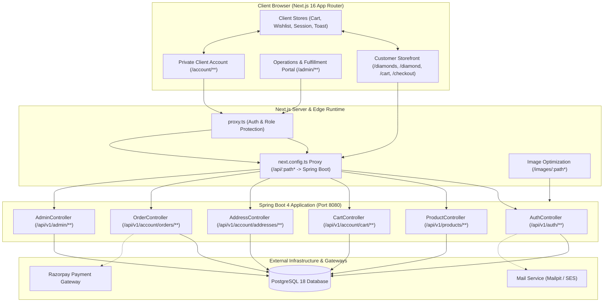

# Keian Luxandor — System Architecture & Engineering Blueprint

This document specifies the technical architecture, dataflow contracts, directory structure, and engineering standards for the **Keian Luxandor** certified loose diamond e-commerce platform.

---

## 1. High-Level System Architecture



---

## 2. Component Responsibility Matrix

| Domain | Scope & Responsibilities | Key Components & Files |
|---|---|---|
| **Catalog & Search** | Diamond list view, multi-facet filtering (origin, carat, shape, 4Cs), dual grid/table view, URL query sync (`query.ts`), smart natural language text search (`search-text.ts`). | `src/app/diamonds/[[...type]]/page.tsx`<br>`src/components/catalog/FilterPanel.tsx`<br>`src/components/catalog/ProductGrid.tsx`<br>`src/components/catalog/ProductTable.tsx` |
| **Loose Diamond PDP** | Metrology details, high-resolution media gallery, 4Cs grade scale visualization, laboratory report check (GIA/IGI), Buy Box with real-time stock & paise pricing. | `src/app/diamond/[slug]/page.tsx`<br>`src/components/diamond/DiamondGallery.tsx`<br>`src/components/diamond/BuyBox.tsx`<br>`src/components/diamond/CertificateModal.tsx` |
| **Cart & Checkout** | Guest cart in localStorage merged upon login, server-side cart calculation, 4-step checkout (Contact $\to$ Address $\to$ Review $\to$ Payment), Razorpay payment bridge. | `src/components/checkout/CartView.tsx`<br>`src/components/checkout/CheckoutFlow.tsx`<br>`src/lib/shop/cart.ts`<br>`src/lib/payments/razorpay.ts` |
| **Customer Account** | Profile and password management, address book (6-digit Indian PIN check, state normalization), order history, digital certificate vault. | `src/app/account/page.tsx`<br>`src/app/account/orders/page.tsx`<br>`src/app/account/addresses/page.tsx`<br>`src/app/account/vault/page.tsx` |
| **Admin Operations** | Loose diamond inventory management, batch CSV import wizard with dry-run verification, order dispatch ledger, packing desk with barcode SKU scan, customer registry. | `src/app/admin/page.tsx`<br>`src/app/admin/inventory/page.tsx`<br>`src/app/admin/orders/page.tsx`<br>`src/components/admin/packing-desk.tsx`<br>`src/components/admin/csv-wizard.tsx` |

---

## 3. Directory Organization Principles

The codebase enforces a **Feature-First Domain Hierarchy**:

```
src/
├── app/                  # Next.js App Router (route handlers, page layouts, metadata)
│   ├── (auth)/           # Authentication routes (login, register, verify-email, reset-password)
│   ├── account/          # Customer portal (profile, orders, addresses, vault)
│   ├── admin/            # Administrative operations desk and order fulfillment
│   ├── diamond/[slug]/   # Dynamic loose diamond Product Detail Page (PDP)
│   ├── diamonds/         # Storefront catalog with category/facet routing
│   └── education/        # Masterclasses (4Cs, shapes, natural vs. lab-grown, certificate reading)
├── components/           # Domain-organized UI components
│   ├── account/          # Profile editor, address book, account navigation
│   ├── admin/            # Operations desk, CSV wizard, packing desk, admin tables
│   ├── catalog/          # Facet filters, product grid, product table, listing toolbar
│   ├── checkout/         # Shopping cart view, multi-step checkout flow, address selector
│   ├── diamond/          # Gallery, BuyBox, certificate modal, 4Cs scales, spec tables
│   ├── layout/           # Global header, announcement bar, mini cart drawer, footer
│   └── ui/               # Reusable primitives (buttons, inputs, dialogs, badges, toaster)
├── config/               # System configuration & progressive feature flags (features.ts)
├── lib/                  # Core domain logic, utilities, and API wrappers
│   ├── api/              # Strongly-typed fetch wrappers for Spring Boot endpoints
│   ├── catalog/          # Query parser, labels, product display helpers, search NLP
│   ├── format.ts         # Currency (formatINR), IST dates, measurement formatting
│   └── types/            # TypeScript interfaces matching backend DTOs & ProblemDetails
└── proxy.ts              # Route protection and role verification (gating /account and /admin)
```

---

## 4. Engineering Standards & Human-Centric Invariants

1. **Strict Integer Paise for All Currency:**
   * Monetary amounts are represented strictly in integer paise ($1 \text{ INR} = 100 \text{ paise}$, e.g. `₹1,85,000` = `18500000`).
   * The browser **never** computes order totals, line discounts, or GST splits. The client solely formats server-provided paise totals using `formatINR()`.
2. **Zero Nested Ternaries Rule:**
   * Nested ternary operators (`a ? b : c ? d : e`) are strictly forbidden. All conditional branching utilizes early returns, guard clauses, or clean `if/else` statements.
3. **Progressive Backend Feature Gating:**
   * Endpoints under development by the backend team are protected by typed switches in `src/config/features.ts`.
   * While a feature flag is disabled, the UI presents an informative, luxury concierge assistance panel rather than throwing broken network errors.
4. **Session Cookie & CSRF Security:**
   * Session authentication uses `JSESSIONID` with `credentials: "include"`.
   * Non-safe HTTP mutations (POST, PUT, DELETE) obtain an `X-CSRF-TOKEN` via `GET /auth/csrf` before executing.
