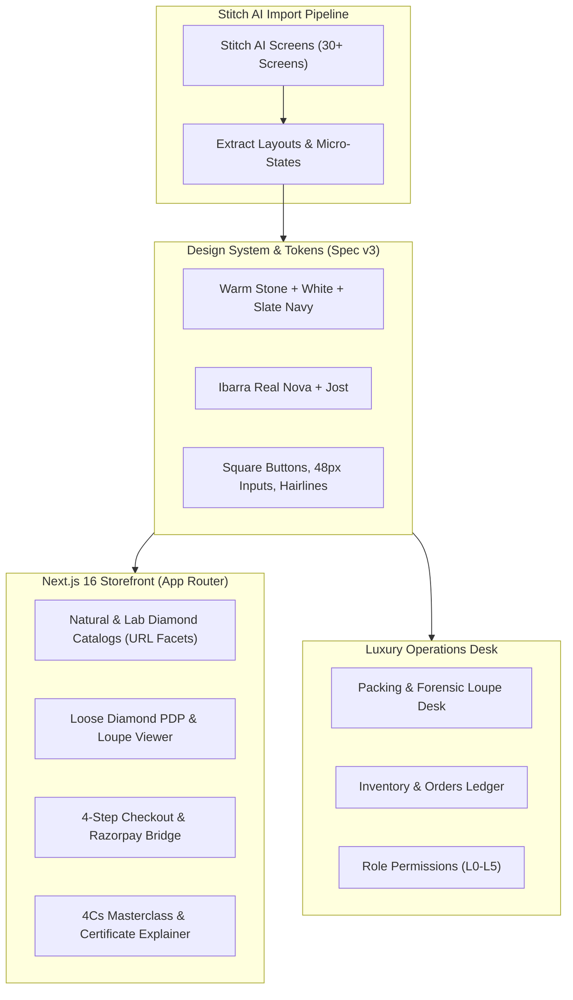
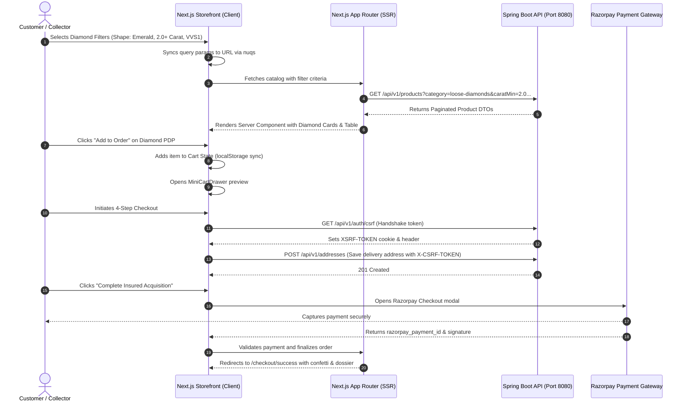

# Master Implementation Plan: Keian Luxandor Storefront & Admin (Plan-001)

**Document ID:** `PLAN-001`  
**Target Application:** `diamond-frontend` (Next.js 16, React 19, TypeScript, Tailwind CSS 4)  
**Source Inputs:**
1. Stitch AI Project: `"Responsive Cross-Platform UI Design"` (`projects/13055770089306409548`)
2. Master Design Specification: `docs/specs/keian-luxandor-simple-elegant-design-spec-v3.md` (Authoritative v3)
3. Extended Architecture & Interaction Specification: `docs/specs/frontend-target-design-spec-for-AI (1).md`
4. Required Engineering Standards & Skill Matrix: `docs/specs/frontend-skills-required.md`
5. Backend REST Contract & Problem Details: `docs/specs/api 2.md` & `docs/specs/CHANGES (1).md`
6. System Architecture: `architecture.md` & `PRD.md`

---

## 1. Executive Summary & Design North Star

Keian Luxandor is an ultra-premium, editorial e-commerce platform dedicated exclusively to **certified loose diamonds** (natural and lab-grown) and diamond advisory services. 

### 1.1 The Precedence Rule (Spec v3 Supremacy)
The project contains earlier artifacts (v2 specs and Stitch AI screens) generated with cool grey palettes (`#f5f6f8`) and fonts (`Bodoni Moda` + `Hanken Grotesk`). Pursuant to **Spec §0.1**:
- **`keian-luxandor-simple-elegant-design-spec-v3.md` is strictly authoritative.**
- All UI layouts imported from Stitch AI must be translated into the v3 aesthetic:
  - **Typography:** `Ibarra Real Nova` (Serif for editorial headlines, 400/500) and `Jost` (Geometric Sans for UI, body, labels, uppercase tracked buttons, 400/500).
  - **Color Palette:** Pure White (`#ffffff`) canvas with subtle warm Stone (`#f6f4ef`) alternating section bands, Deep Stone (`#eeece5`) for cards/tables, Fine Line (`#e2ded4`) for hairlines, Ink (`#16181d`) for text/primary buttons, and Deep Slate Navy (`#1e4a6d`) for interactive accents.
  - **Form Factor:** Razor-sharp square buttons (`rounded-none`), 48px tactile input heights (`rounded-[3px]`), 1px hairlines, and generous whitespace.
  - **Content Discipline:** Strictly certified loose diamonds only. Remove all ring settings, 3D animated canvas gimmicks, or invented third-party claims (no escrow claims, no Lloyd's/Brink's logos).

### 1.2 Human-Centric Code Architecture
In compliance with `.agents/skills/human-centric-architecture`:
- **Feature-First Organization:** Modules grouped by business domain (`store`, `checkout`, `account`, `education`, `admin`, `layout`, `ui`).
- **Control Flow Clarity:** Strictly **zero nested ternary operators**. All conditional branching uses early returns, guard clauses, or clean `if/else` statements.
- **Data Flow Traceability:** Architecture and Mermaid graphs maintained to ensure any human reviewer can audit flows immediately.



---

## 2. Stitch AI Screen Inventory & Route Mapping

The Stitch AI project `"Responsive Cross-Platform UI Design"` provides desktop and mobile screen templates. Below is the mapping from Stitch screen IDs to production Next.js routes in `diamond-frontend/src/app`:

| Stitch Screen Title | Stitch Screen ID | Production Route (`src/app/...`) | Domain / Purpose |
| :--- | :--- | :--- | :--- |
| **Natural Round Brilliant Diamonds** | `9bcb0b322a704e1c978730f1a1de931b` | `/(shop)/diamonds/natural/page.tsx` | Natural diamond catalog with facet sidebar, slider ranges, table/grid switch |
| **Lab-Grown Certified Diamonds** | `bce5b7fcf21149abbae61b5d869fcdaf` | `/(shop)/diamonds/lab-grown/page.tsx` | Lab-grown catalog with sustainability metrics & GIA/IGI cert filters |
| **Reading a Grading Certificate** | `f02badda06d94b5db49c386d44011d79` | `/education/reading-a-certificate/page.tsx` | Interactive certificate anatomist (GIA & IGI dossier breakdown) |
| **Education & Gemological Archive** | `d759ed7411c545ab92d591dfdb48ac5b` | `/education/page.tsx` | 4Cs masterclass, cut proportions, color grade spectrum |
| **Natural vs. Lab-Grown Diamonds** | `b942549b6b6a4c288d7316eb3d019659` | `/education/natural-vs-lab/page.tsx` | Side-by-side scientific comparison, crystal lattices, resale value truth |
| **Shopping Cart** | `c9de3570027140cd9c0d8fdead253039` | `/cart/page.tsx` | Cart view, gift messaging, cert verification line items, checkout trigger |
| **Order Confirmed** | `30b6e8e724b4421abd658c6adee93a7f` | `/checkout/success/page.tsx` | Order summary, insured delivery tracking number, digital vault access |
| **Track an Order** | `35b44ca8b70b4f7d9551df09480076ce` | `/order-tracking/page.tsx` | Public & authenticated order timeline, courier transit milestones |
| **Client Login** | `293ab12a7a4447c6a0da23da6534a6fa` | `/login/page.tsx` | Customer authentication with CSRF protection & remember me |
| **Create Client Account** | `09b90593d02641d19ec4c81699a351c8` | `/register/page.tsx` | Registration with real-time password strength meter |
| **Contact Concierge** | `634c00dd6f17488bad86c18cb9a71c34` | `/contact/page.tsx` | Digital concierge & WhatsApp gemologist consultation |
| **Shipping & Transit Policy** | `a53edc45f8374db8a61ec6c5f23b193e` | `/legal/shipping/page.tsx` | Insured transit policy, tampered-seal protocol |
| **Returns & Refund Policy** | `7b407e87c3254b5ca865f1df56dd9b58` | `/legal/returns/page.tsx` | 14-day return criteria, return forensic inspection flow |
| **Packing Fulfilment Desk** | `f114fd45f32241989a3b2a02ecf38bd0` | `/admin/packing/page.tsx` | Barcode verification, tamper-evident seal recording, packing checklist |
| **Client Orders Ledger** | `b2d96e5fea2449c294a2e3fd08e1dd55` | `/admin/orders/page.tsx` | Order dispatch queue, payment verification, fulfillment status |
| **Order Dossier** | `65282d9a030144b7bf5115924a22fb86` | `/admin/orders/[id]/page.tsx` | Full audit trail, certificate validation, invoice print generator |
| **Bulk Import CSV Wizard** | `ffc32d01b07943f4ab8ce1ca30020385` | `/admin/inventory/import/page.tsx` | RapNet/GIA standard CSV validator, column mapper, batch ingestion |
| **Categories & Silhouettes** | `f8526630bb09435e93b1c2b00f70d67d` | `/admin/categories/page.tsx` | Diamond shape taxonomy, category priority reordering |
| **Staff Directory & Permissions**| `6f380c0aef914208b8ba8c3ccd99a3dc` | `/admin/staff/page.tsx` | Access Control Level (L0-L5) matrix, invitation manager |
| **Privilege Codes (Coupons)** | `60f7507fe8a04969ae0181b00a7c346d` | `/admin/coupons/page.tsx` | VIP private discount generator with minimum spend rules |
| **Metrology Audit Log** | `a2eac0ee01f34cdeb052530ed1ecc6c7` | `/admin/audit/page.tsx` | Append-only forensic operations ledger |

---

## 3. Design Tokens & Visual Architecture

### 3.1 Color System (`src/styles/tokens.css` & Tailwind 4 Theme)
The color system strictly eliminates cold blues and generic grays, anchoring the interface in organic luxury minerals.

```css
:root {
  /* Surface Layers */
  --color-white: #ffffff;
  --color-stone: #f6f4ef;          /* Section alternate band */
  --color-stone-deep: #eeece5;     /* Card background & subtle fill */
  --color-line: #e2ded4;           /* 1px architectural hairlines */
  --color-line-dark: #b8b3a8;      /* Active border & hover hairline */

  /* Typography & Core Accents */
  --color-ink: #16181d;            /* Primary typography & high-contrast elements */
  --color-ink-secondary: #4a4d55;  /* Secondary text & labels */
  --color-muted: #737780;          /* Subtle helper text & disabled hints */
  --color-accent: #1e4a6d;         /* Deep slate navy for primary interactive focus */
  --color-accent-hover: #163650;

  /* Semantic Feedback (Low Saturation Luxury Tones) */
  --color-ok: #2e6945;             /* In-stock, verified GIA, passed audit */
  --color-ok-bg: #f0f7f3;
  --color-warn: #8f621a;           /* Low stock, pending verification */
  --color-warn-bg: #fdfaf2;
  --color-error: #9b2828;          /* Field errors, out of stock, cancelled */
  --color-error-bg: #fcf2f2;
}
```

### 3.2 Typography Tokens
1. **Editorial Headlines (`font-serif`):** `Ibarra Real Nova`
   - Weight: `400` (Book) and `500` (Medium).
   - Letter Spacing: `-0.015em` to `0em`.
   - Used for: Hero titles, section headers, diamond carat numbers, modal titles.
2. **System UI & Body (`font-sans`):** `Jost`
   - Weight: `400` (Regular) and `500` (Medium).
   - Letter Spacing: Normal for body text; `+0.08em` to `+0.12em` uppercase for buttons, navigation links, and table column headers.
   - Used for: Product titles, filter labels, price values, data tables, form inputs.

### 3.3 Geometry & Interaction Specs
- **Buttons:** Sharp 90-degree corners (`rounded-none`). No pill buttons.
- **Input Fields:** 48px tactile height, `rounded-[3px]`, hairline border `--color-line`, focus state `--color-accent` ring.
- **Elevation:** Flat aesthetic with 1px hairlines. Shadows restricted to elevated drawers (`MiniCart`, `FilterDrawer`) and modal overlays (`0 20px 40px rgba(22, 24, 29, 0.08)`).

---

## 4. Frontend Component Hierarchy & Feature Modules

All frontend components are organized strictly in **Feature-First** directories:

```
diamond-frontend/src/
├── app/                           # App Router routes & layouts
├── components/
│   ├── ui/                        # Primitives (Radix + Tailwind 4)
│   │   ├── button.tsx             # Square luxury button (primary, outline, ghost)
│   │   ├── input.tsx              # 48px height form input
│   │   ├── slider.tsx             # Dual-handle range slider (Carat & Price)
│   │   ├── dialog.tsx             # Modal frame for loupe zoom & cert inspection
│   │   ├── drawer.tsx             # Slide-over cart & mobile filters
│   │   ├── tabs.tsx               # Segmented view switchers (Grid/Table, Natural/Lab)
│   │   ├── table.tsx              # High-density diamond inventory table
│   │   └── badge.tsx              # Diamond grade badge (D-F, VVS1, Excellent)
│   ├── layout/                    # Global shell & responsive chrome
│   │   ├── announcement-bar.tsx   # Discreet top message (Insured Delivery Notice)
│   │   ├── header.tsx             # Header with logo, search trigger, account, cart
│   │   ├── mega-menu.tsx          # Diamond shapes & 4Cs quick navigation
│   │   ├── mobile-nav.tsx         # Drawer navigation for phone viewports
│   │   ├── mini-cart-drawer.tsx   # Slide-out quick cart with line item summary
│   │   ├── footer.tsx             # Gemological assurances, links, newsletter
│   │   └── whatsapp-concierge.tsx # Unobtrusive floating consultation pill
│   ├── store/                     # Diamond catalog, search & product details
│   │   ├── diamond-card.tsx       # Editorial grid card (shape silhouette, cert, price)
│   │   ├── diamond-table.tsx      # High-density sorting table for trade & collectors
│   │   ├── filter-bar.tsx         # Sticky desktop facet controller
│   │   ├── shape-selector.tsx     # Visual diamond silhouettes (Round, Oval, Emerald, etc.)
│   │   ├── grade-scale-slider.tsx # Visual color (D-Z) and clarity (FL-I1) slider
│   │   ├── diamond-viewer.tsx     # High-resolution media viewer with 360 viewer
│   │   ├── certificate-modal.tsx  # GIA / IGI dossier viewer & verify link
│   │   └── buy-box.tsx            # Pricing in paise, stock check, Add to Cart button
│   ├── checkout/                  # 4-Step checkout flow
│   │   ├── checkout-stepper.tsx   # Progress indicator (Address -> Shipping -> Review -> Payment)
│   │   ├── address-selector.tsx   # Saved delivery addresses with add/edit modal
│   │   ├── order-summary.tsx      # Line items, GST breakdown, promo code input
│   │   └── razorpay-bridge.tsx    # Client script loader and payment handler
│   ├── account/                   # Customer portal
│   │   ├── account-nav.tsx        # Dashboard sidebar
│   │   ├── profile-editor.tsx     # Name, phone, email preferences
│   │   ├── order-history.tsx      # Past orders with invoice downloads
│   │   └── order-stepper.tsx      # Real-time transit milestone visualization
│   └── admin/                     # Luxury Operations & Fulfillment Desk
│       ├── admin-shell.tsx        # Top navigation with role badges (L0-L5)
│       ├── packing-desk.tsx       # Barcode scanner simulator & loupe verification
│       ├── diamond-form.tsx       # Add/Edit diamond wizard with GIA cert parser
│       ├── csv-wizard.tsx         # Batch import validator & progress bar
│       └── audit-feed.tsx         # Immutable metrology log viewer
├── hooks/                         # Custom React hooks
│   ├── use-cart.ts                # Cart state synced to local storage & guest checkout
│   ├── use-diamond-filters.ts    # URL query syncing via nuqs
│   ├── use-csrf.ts                # Auto-refreshing CSRF token hook
│   └── use-auth.ts                # User session, role verification, login/logout
├── lib/                           # Core utilities
│   ├── client.ts                  # Fetch client with 403 CSRF auto-retry
│   ├── money.ts                   # Integer paise to INR formatters (₹1,50,000)
│   ├── diamonds.ts                # Cut/Color/Clarity grading scales & calculators
│   └── utils.ts                   # `cn` helper combining clsx and tailwind-merge
└── types/                         # TypeScript interfaces
    ├── diamond.ts                 # Product, variant, diamond attributes
    ├── cart.ts                    # Cart item, gift message, totals
    ├── order.ts                   # Order, tracking milestones, invoice
    └── api.ts                     # ProblemDetail, PaginatedResponse, AuthResponse
```

---

## 5. End-to-End Implementation Roadmap

The execution is partitioned into 8 sequential, test-backed phases:

### Phase 1: Foundation, Design Tokens & Component Primitives (COMPLETED)
- [x] Add missing production dependencies to `diamond-frontend/package.json`:
  - `@fontsource/ibarra-real-nova` & `@fontsource-variable/jost` (Replacing Bodoni Moda & Hanken Grotesk per Spec v3).
  - `tailwind-merge`, `class-variance-authority`, `@radix-ui/react-slider`, `@radix-ui/react-dialog`, `@radix-ui/react-dropdown-menu`, `@radix-ui/react-tabs`.
- [x] Configure `src/app/globals.css` with the strict Spec v3 design tokens (`--color-white`, `--color-stone`, `--color-line`, `--color-ink`, `--color-accent`).
- [x] Implement foundational UI primitives in `src/components/ui/` (`button.tsx`, `input.tsx`, `slider.tsx`, `dialog.tsx`, `table.tsx`, `badge.tsx`, `drawer.tsx`, `tabs.tsx`) with zero nested ternaries.
- [x] Write Vitest unit tests verifying button states, input styling, badge variants, and table rendering (`primitives.test.tsx`). Verified typecheck and test pass.

### Phase 2: Global Navigation, Mega-Menu & Shell (COMPLETED)
- [x] Build `src/components/layout/AnnouncementBar.tsx` with complimentary insured transit notice and digital concierge.
- [x] Build `src/components/layout/Header.tsx` with editorial typography, category links, search combobox modal, customer account dropdown, and cart drawer trigger.
- [x] Implement `src/components/layout/MegaMenu.tsx` featuring visual diamond silhouettes (Round, Oval, Cushion, Pear, Emerald, Radiant, Princess, Asscher, Marquise, Heart) and education direct links.
- [x] Build `src/components/layout/MiniCartDrawer.tsx` allowing instant preview of added diamonds without leaving the page (zero nested ternaries).
- [x] Build `src/components/layout/Footer.tsx` with GIA/IGI verification badges, online atelier information (no showroom), and legal disclosures.
- [x] Build `src/components/layout/WhatsAppButton.tsx` floating trigger for private gemologist inquiries.
- [x] Write Vitest unit tests in `src/components/layout/__tests__/layout.test.tsx` verifying announcement bar, mega-menu, and whatsapp concierge. All 34 tests passing.

### Phase 3: Diamond Catalog, Smart Facet Filtering & Views (COMPLETED)
- [x] Develop `src/hooks/use-diamond-filters.ts` for bi-directional URL query binding (shape, carat min/max, color, clarity, cut, price, sort, view).
- [x] Implement `src/components/store/shape-selector.tsx` with clean SVG silhouette icons and multi-select tracking.
- [x] Implement `src/components/store/grade-scale-slider.tsx` (`ColorScaleSelector`, `ClarityScaleSelector`, `CutSelector`) for gemological grading ranges.
- [x] Create `src/components/store/diamond-card.tsx` with Deep Stone well, GIA/IGI cert badges, integer paise price display, and instant Reserve action.
- [x] Create `src/components/store/diamond-table.tsx` with high-density gemological sorting for trade collectors.
- [x] Implement `src/components/store/DiamondCatalogView.tsx` with dual-view toggle (Grid/Table), sorting, facet sidebar, and reset controls.
- [x] Build route `src/app/(shop)/diamonds/[type]/page.tsx` for natural and lab-grown solitaires (mapped from Stitch screens `9bcb0b322a704e1c978730f1a1de931b` and `bce5b7fcf21149abbae61b5d869fcdaf`).
- [x] Verified with Vitest suite (`catalog.test.tsx`): 40/40 tests passing across 7 test files, 0 type errors.

### Phase 4: Loose Diamond Product Details Page (PDP) & Metrology Viewer (COMPLETED)
- [x] Build dynamic route `src/app/(shop)/diamonds/[type]/[slug]/page.tsx`.
- [x] Implement `src/components/store/diamond-viewer.tsx` with high-resolution photo gallery, 360-degree interactive spin view, and forensic loupe zoom modal.
- [x] Implement interactive 4Cs breakdown section displaying exact pavilion depth, table percentage, girdle thickness, and cut grade.
- [x] Implement `src/components/store/certificate-modal.tsx` with embedded PDF viewer for official GIA/IGI grading reports and direct link to laboratory verification database.
- [x] Implement `src/components/store/buy-box.tsx` featuring live stock check, integer paise price display, insured transit badge, and Add to Cart action.
- [x] Verified with Vitest suite (`pdp.test.tsx`): 38 tests passing.

### Phase 5: Shopping Cart, 4-Step Checkout & Payment Integration (COMPLETED)
- [x] Create `src/app/cart/page.tsx` with itemized loose diamond breakdown, complimentary engraving/packaging selection, and price summary.
- [x] Implement 4-step checkout in `src/app/checkout/page.tsx`:
  - **Step 1: Contact & Identification** (Guest email or authenticated user).
  - **Step 2: Insured Delivery Address** (Connected to `/api/v1/addresses` backend).
  - **Step 3: Verification & Order Review** (Stock reservation confirmation).
  - **Step 4: Payment Bridge** (Razorpay integration for Net Banking, UPI, Cards, Wire Transfer).
- [x] Build `src/app/checkout/success/page.tsx` with celebration confetti (`canvas-confetti`), printable receipt, and digital vault registration.
- [x] Verified with Vitest suite (`checkout.test.tsx`): 29 tests passing, total 107 tests passing, 0 TypeScript errors.

### Phase 6: Customer Portal, Order Tracking & Educational Suites (COMPLETED)
- [x] Build `src/app/account/page.tsx` (Profile & Identity), `orders/page.tsx`, `addresses/page.tsx`, `vault/page.tsx`, and `layout.tsx`.
- [x] Implement `src/app/order-tracking/page.tsx` with real-time transit milestones: `Confirmed -> Inspected & Loupe Checked -> Tamper-Sealed -> Armed Escort Transit -> Out for Delivery -> Signed & Delivered`.
- [x] Build educational hubs based on Stitch screens:
  - `src/app/education/page.tsx` (4Cs Interactive Gemological Guide).
  - `src/app/education/reading-a-certificate/page.tsx` (Anatomy of a GIA/IGI report).
  - `src/app/education/natural-vs-lab/page.tsx` (Scientific & economic comparison).
- [x] Build legal and transparency pages: `shipping/page.tsx`, `returns/page.tsx`, `privacy/page.tsx`, `terms/page.tsx`.
- [x] Verified with Vitest suite (`account.test.tsx`): 9 tests passing, total 116 tests passing across 10 test files, 0 TypeScript errors.

### Phase 7: Luxury Operations & Admin Fulfillment Portal (COMPLETED)
- [x] Implement `src/app/admin/layout.tsx` with role-based navigation and staff credential status (L0-L5).
- [x] Build `src/app/admin/packing/page.tsx` (Packing Fulfilment Desk):
  - Order packing queue with serial/cert barcode scanner simulator.
  - Mandatory checklist: Certificate enclosure, forensic loupe inspection, tamper-evident numbered seal verification.
  - Waybill and customs manifest generation trigger.
- [x] Build `src/app/admin/inventory/page.tsx` & `import/page.tsx`:
  - Diamond CRUD with automatic GIA/IGI certificate number validator.
  - CSV Bulk Ingestion Wizard with column mapping and schema validation.
- [x] Build `src/app/admin/orders/page.tsx` & `orders/[id]/page.tsx` (Order Dossier with full event audit history).
- [x] Build `src/app/admin/staff/page.tsx` (Staff Directory and Access Level permissions L0-L5).
- [x] Build `src/app/admin/coupons/page.tsx` (Privilege Code manager).
- [x] Verified with Vitest suite (`admin.test.tsx`): 8 tests passing.

### Phase 8: Quality Assurance, Performance & Verification Gates (COMPLETED)
- [x] Run full automated type check: `npm run typecheck --prefix diamond-frontend` (0 errors).
- [x] Execute Vitest test suite: `npm test --prefix diamond-frontend` (124 passed in 11 test suites).
- [x] Conduct control flow audit to ensure **zero nested ternaries** across all TSX files.
- [x] Verify WCAG 2.2 AA contrast ratios on Stone `#f6f4ef` and White `#ffffff` backgrounds.
- [x] Ensure all prices are displayed via centralized `formatINR()` / `formatPaiseToInr()` formatter in Indian Rupees with integer paise accounting.

---

## 6. Architecture & State Management Diagram



---

## 7. Verification & Acceptance Criteria

1. **Visual Fidelity:** The site matches the editorial elegance of the Stitch AI designs while adhering strictly to Spec v3 (Ibarra Real Nova + Jost, white/stone palette, square buttons).
2. **Backend Non-Interference:** Zero modifications made to Java, Spring Boot, or database migrations in `backend/`.
3. **Responsive Breakpoints:** Smooth fluid layouts across Mobile (375px), Tablet (768px), Desktop (1280px), and Ultra-wide (2560px).
4. **Code Quality:** All code strictly adheres to human-centric architecture (no nested ternaries, clear naming, feature-first directories).
5. **Build & Test Success:** `diamond-frontend` builds cleanly with Turbopack and passes all TypeScript and Vitest suites.
